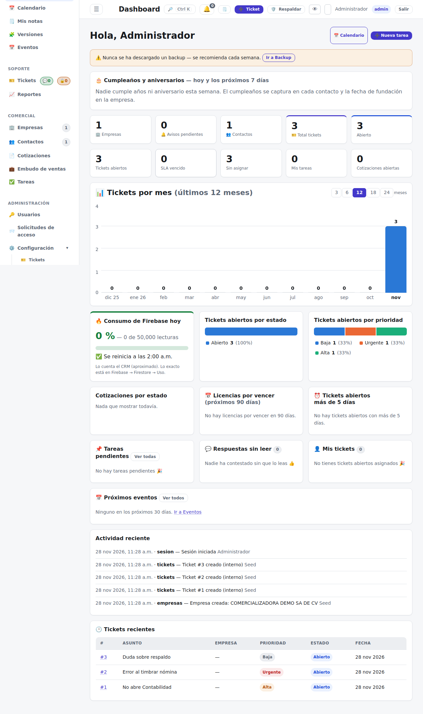

Al entrar al back-office (`/app`) llegas al panel principal, con métricas acotadas a lo que
tu rol puede ver (un agente solo ve lo suyo; admin/supervisor/lectura ven el global).

## Qué muestra

- **Tickets**: abiertos, pendientes, resueltos en el periodo, y los que están por vencer o
  vencidos de SLA.
- **Cotizaciones**: cuántas están en borrador, enviadas y aprobadas.
- **Próximos eventos**: los de los siguientes 30 días (webinars, presenciales y felicitaciones), con su tipo y fecha. Los que siguen en borrador salen con «📝 en preparación».
- **Actividad reciente**: últimas entradas de la bitácora relevantes a tu rol.
- **⏰ Recordatorios de tus notas**: las notas de *Mis notas* a las que les pusiste recordatorio
  para hoy (o que ya se pasaron). Solo ves las tuyas.
- **🔥 Consumo de Firebase hoy**: cuántas de las 50 mil lecturas diarias gratuitas de la base
  de datos se llevan gastadas (ver abajo).

Las barras y totales se recalculan en cada carga de la página; no hay botón de "actualizar"
porque no cachea nada.

## Para qué sirve

Es el punto de partida del día: de un vistazo ves si hay tickets urgentes sin atender o
vencidos, y saltas a *Tickets* o a tu panel de *Mis asignados* desde el menú lateral.

## 🔥 Consumo de Firebase

El CRM guarda sus datos en Firebase (Firestore), que en el plan gratuito permite **50 mil
lecturas al día**. Si se acaban, **nadie puede entrar al CRM** hasta que se reinicia la cuota:
a las **2:00 a.m.** (1:00 a.m. cuando EE. UU. está en horario de verano).

La tarjeta muestra:

- El **porcentaje** gastado hoy y la barra de color: verde, amarilla a partir del 60 % y roja a
  partir del 80 %.
- El **ritmo** de la última hora y, si a ese ritmo se acabaría antes de reiniciarse, cuántas
  horas quedan (⚠️).
- Una gráfica de **lecturas por hora**, para ver a qué hora se gasta más.

Cuando pasa del **80 %**, en la barra de arriba de **todas** las pantallas aparece el botón rojo
**«🔥 Firebase N %»**. Si lo ves, conviene cerrar pestañas del CRM que no se estén usando: cada
pestaña abierta consulta la campana 🔔 cada minuto.

La cuenta la lleva el propio CRM y es **aproximada** (no incluye lo que se consulta desde la
consola de Firebase). El dato exacto está en Firebase → Firestore → Uso.
